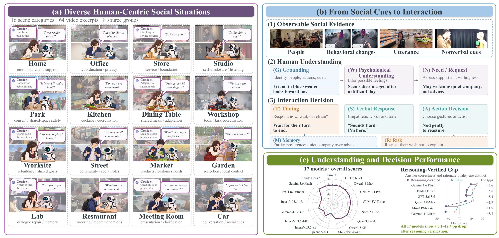
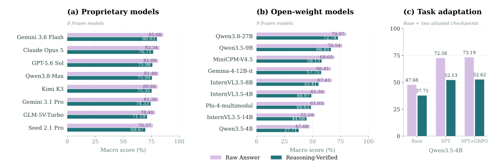

<p align="center">
  <a href="https://psychemme.github.io/">
    
  </a>
</p>

<h2 align="center">A Psychology-Informed Benchmark<br>for Social Understanding and Interaction in Videos</h2>

<p align="center">
  <a href="https://psychemme.github.io/"></a>
  <a href="docs/QUICKSTART.md"></a>
  <a href="https://arxiv.org/abs/2610.28625"></a>
  <a href="https://github.com/psychemme/PsycheMME/issues"></a>
</p>

<p align="center">
  <a href="#-overview">Overview</a> ·
  <a href="#-update">Update</a> ·
  <a href="#-installation">Installation</a> ·
  <a href="#-usage">Usage</a> ·
  <a href="#-experiment">Experiment</a> ·
  <a href="#-citation">Citation</a>
</p>

# 🧠 Overview

**Can a video model understand what a person needs, when to respond, and why?**

PsycheMME evaluates social understanding and interaction through **1,000 questions**, **630 video episodes**, and **eight psychology-informed capabilities**. It connects social cues with psychological understanding, needs, response timing, verbal responses, actions, memory, and risk. **Reasoning-Verified** scoring evaluates answer correctness together with explicit evidence support and logical consistency.

<p align="center"></p>

## Resources

| Resource | Contents |
| :--- | :--- |
| [Benchmark](https://huggingface.co/datasets/psychemme/PsycheMME) | Questions, references, 630 videos, ASR and source mappings |
| [SFT adapter](https://huggingface.co/psychemme/PsycheMME-Qwen3.5-4B-SFT) | Qwen3.5-4B LoRA adapter |
| [GRPO adapter](https://huggingface.co/psychemme/PsycheMME-Qwen3.5-4B-GRPO) | Qwen3.5-4B LoRA adapter |
| [Evaluation records](https://huggingface.co/datasets/psychemme/PsycheMME-logs) | Question-level scores and paper tables |

# 📣 Update

- The benchmark, evaluation tools and model adapters are available.

# 🛠️ Installation

Use **Python 3.11** and install [FFmpeg](https://ffmpeg.org/download.html) for video processing (`brew install ffmpeg` on macOS; `sudo apt-get install ffmpeg` on Ubuntu).

```bash
git clone https://github.com/psychemme/PsycheMME.git
cd PsycheMME
python3.11 -m venv .venv
source .venv/bin/activate
python -m pip install '.[data]'
```

# 🚀 Usage

## Evaluate your model

Configure an image-capable chat-completions endpoint and a text Judge in `.env`:

```bash
cp .env.example .env
# Fill in MODEL_BASE_URL, MODEL_ID, MODEL_API_KEY,
# JUDGE_BASE_URL, JUDGE_MODEL and JUDGE_API_KEY.
# Add your official Ego4D AWS credentials for the video download.
bash scripts/evaluate.sh
```

This downloads the benchmark, runs **Infer → Judge → Score**, and saves `predictions.jsonl`, `judgments.jsonl` and `scores.summary.json` in `runs/my-model/`.

Repeat the same command to continue an interrupted run. Completed records are reused. After resolving a transient endpoint error, explicitly retry saved execution errors with `RETRY_ERRORS=1` before the command. Use a new `RUN_DIR` when changing the model or evaluation settings.

## Document

| Task | Guide |
| :--- | :--- |
| First evaluation | [Quick Start](docs/QUICKSTART.md) · [中文指南](docs/QUICKSTART.zh-CN.md) |
| API, local models and custom predictions | [Model Integration](docs/MODEL_INTEGRATION.md) |
| Questions, transcripts and references | [Data Format](docs/DATA_FORMAT.md) |
| Raw and Reasoning-Verified metrics | [Evaluation](docs/EVALUATION.md) |
| Setup and runtime help | [Troubleshooting](docs/TROUBLESHOOTING.md) |

## Getting data

```bash
bash scripts/download.sh
```

Includes 1,000 questions and references, 630 videos, ASR and source mappings. Apply for [Ego4D access](https://ego4d-data.org/docs/start-here/) and fill the supplied AWS credentials in `.env`. The script fetches only 76 required Ego4D source videos from the official service, prepares 142 clips, and downloads the other seven video sources from Hugging Face. See [Download Guide](docs/DOWNLOAD.md) for setup, storage and reuse. Add `--metadata-only` for annotations only.

```python
from datasets import load_dataset
questions = load_dataset("psychemme/PsycheMME", "questions", split="test")
```

Install `datasets` separately for this Python example. References are provided in `benchmark/ground_truth.jsonl` for judging and scoring; model inference uses public questions, supplied context, ASR and video.

## Run an adapter on your video

```bash
python -m pip install '.[local-model]'
psychemme video --video /path/to/clip.mp4 \
  --question "What social cues indicate that the person needs support?" \
  --adapter psychemme/PsycheMME-Qwen3.5-4B-SFT \
  --adapter-revision v1.0.2 --output runs/video.json
```

Use the GRPO repository ID to run the GRPO adapter, or omit adapter arguments to run the base model. Both adapters load directly on `Qwen/Qwen3.5-4B`. See [Video Inference](docs/VIDEO.md) for CUDA dependencies and ASR input.

## Training and construction

SFT and GRPO adapters are available above. Training data, training recipes and the construction pipeline will be released separately.

<details><summary><b>Repository layout</b></summary>

```text
PsycheMME/
├── assets/                  # Figures and logo
├── code/
│   ├── psychemme_eval/      # Inference, judging, scoring and CLI
│   ├── configs/             # Evaluation settings
│   ├── reference_core/      # Reference implementations
│   └── tests/
├── docs/                    # Guides
├── manifests/               # Resource index
├── scripts/                 # Evaluation and downloads
├── schemas/                 # Data formats
└── pyproject.toml
```

</details>

# 📊 Experiment

The paper compares **17 frozen models** and separately studies **SFT and GRPO** adaptation. Raw measures answer correctness; Reasoning-Verified additionally assesses explicit evidence support and logical consistency. Both headline metrics average equally over the eight capabilities.

<p align="center"></p>

Explore [results and examples](https://psychemme.github.io/#results) on the project page.

## Recompute paper scores

```bash
bash scripts/replay.sh
```

Recomputes **19,000 question-level scores** from the released answer credit and rationale factors and checks **190 paper-table values** on CPU. Expected result: `PASS`. Details: [Reproduction Guide](docs/REPRODUCIBILITY.md).

# 📝 Citation

If you find PsycheMME useful in your research, please cite our work.

```bibtex
@misc{hu2026psychemme,
  title={PsycheMME: A Psychology-Informed Benchmark for Social Understanding and Interaction in Videos},
  author={Heran Hu and Yuhang Dong and Zhucun Xue and Kaiwei Chen and Yong Liu and Jiangning Zhang},
  year={2026},
  eprint={2610.28625},
  archivePrefix={arXiv},
  primaryClass={cs.CV},
  url={https://arxiv.org/abs/2610.28625}
}
```

# 🤝 Acknowledgement

We thank the creators of the source datasets and the open-source model and software communities that support this work. Source attribution and access terms are provided with the dataset.

Questions or suggestions? Join the conversation through [GitHub Issues](https://github.com/psychemme/PsycheMME/issues).

# 📄 License

Code is released under [Apache-2.0](LICENSE). Dataset annotations and third-party media follow their respective licenses and source terms, provided with the dataset.
